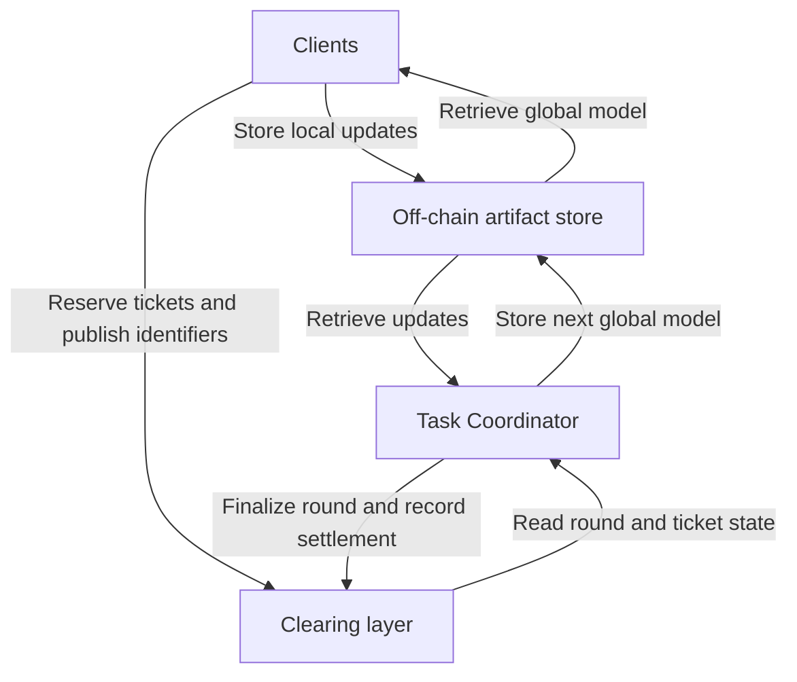
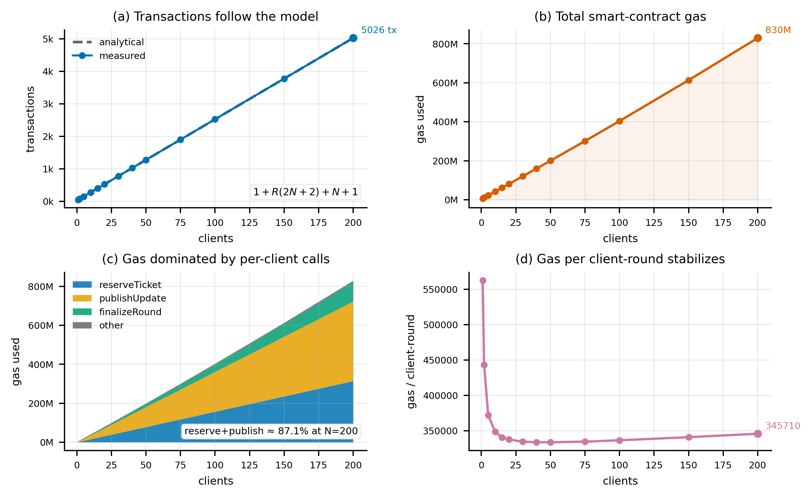
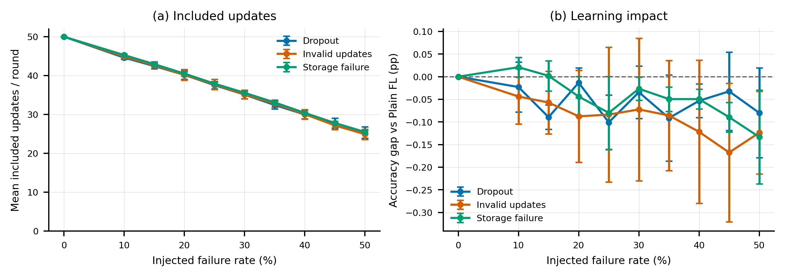

# AuditFL

### Auditable coordination for open federated learning

[](https://arxiv.org/abs/2610.41278)

**[Paper](https://arxiv.org/abs/2610.41278) · [Quickstart](#quickstart) · [Results](#reported-results) · [Reproduction](#reproduce-the-experiments) · [Citation](#citation)**

AuditFL records participation and settlement on a ledger while model training and aggregation stay off chain. It combines deposit-backed update tickets, content-addressed model artifacts, and an explicit record of round finalization, refunds, rewards, and claims.

**Paper:** *AuditFL: A Contract-Backed Clearing Layer for Open Federated Learning*  
**Authors:** Alexandros Balla and Spyros Lalis

## How it works



The Task Coordinator retrieves artifacts, checks their integrity and shape, aggregates included updates, and finalizes each round. The clearing layer records identifiers and economic state; model tensors remain in the off-chain store.

| Backend | Purpose |
|---|---|
| **Python state machine** | Fast local execution and controlled failure experiments |
| **Solidity on Anvil** | Local EVM execution, transaction receipts, and measured gas usage |

Both backends share the Python training and coordination code and a local SHA-256 content-addressed artifact store.

## Quickstart

Run a clean comparison with **10 clients and four rounds** using the built-in scikit-learn digits dataset. After dependencies are installed, this run needs no blockchain node or dataset download.

From a Bash-compatible shell:

```bash
git clone https://github.com/katastrofh/AuditFL.git
cd AuditFL
python3 -m venv .venv
source .venv/bin/activate
python3 -m pip install -r requirements.txt

python3 -m scripts.run_contract_mvp \
  --backend mock \
  --dataset digits \
  --clients 10 \
  --quick \
  --seed 7 \
  --out results_mock_quick
```

`--quick` sets the round count to four. The output directory contains:

| File | Contents |
|---|---|
| `plain_fl_rounds.csv` | Plain FL accuracy by round |
| `bcfl_mock_rounds.csv` | AuditFL accuracy, inclusion, and fault counters by round |
| `contract_mock_receipts.csv` | State-machine operations and modeled gas estimates |
| `contract_mvp_summary.csv` | Run configuration and final metrics |
| `paper_ready_notes.md` | Human-readable run summary |

The smoke run was checked with Python 3.12.14, NumPy 2.3.5, pandas 2.2.3, and scikit-learn 1.8.0. It produced matching Plain FL and AuditFL accuracy trajectories, 99 mock receipts, 45 stored artifacts, and no failed artifact reads. These versions record the checked environment; the dependency files currently do not pin exact versions.

## Reported results

### Clean scaling on full MNIST

The archived scaling experiments use **70,000 MNIST examples, 12 rounds, and 1–200 clients**, with a non-IID Dirichlet split (`alpha = 0.4` for multiple clients). The Solidity contract runs on a local Anvil chain.

At **200 clients**:

| Transactions, including deployment | Off-chain artifacts | Artifact volume | Total EVM gas |
|---:|---:|---:|---:|
| **5,026** | **2,413** | **144.9 MiB** | **829.7 million** |

The archived clean runs have zero final-accuracy gap between Plain FL and AuditFL. Both use the same model, data split, local training, and aggregation procedure; AuditFL changes the coordination and settlement path.



**Inspect the evidence:** [scaling summary CSV](Results/auditfl_scaling_full_mnist_summary_N1_to_N200.csv) · [gas by operation CSV](Results/auditfl_scaling_full_mnist_gas_by_operation_N1_to_N200.csv) · [storage scaling figure](paper_figures/fig_storage_scaling_v2.png)

### Controlled failure experiments

The state-machine experiments use **50 clients, 12 rounds, and three seeds**, injecting dropout, malformed updates, or unavailable artifacts separately at rates from 0% to 50%.

At **50% injected failure**, the mean final-accuracy decrease relative to Plain FL is approximately **0.080 percentage points for dropout, 0.124 for malformed updates, and 0.133 for unavailable artifacts**. These are means across three seeds for that failure rate, under the implemented fault model.



**Inspect the evidence:** [aggregate CSV](Results/auditfl_failure_sweep_mnist_full_N50_aggregate.csv) · [individual-run CSV](Results/auditfl_failure_sweep_mnist_full_N50_all_runs.csv)

## Reproduce the experiments

Start with the quickstart above. The commands below run from the repository root with the Python environment activated, except where a subshell explicitly changes directories.

<details>
<summary><strong>Render the paper figures from archived CSVs</strong></summary>

This regenerates plots from the checked-in data without rerunning training:

```bash
(
  cd Results
  MPLBACKEND=Agg python3 ../scripts/plot_scaling_paper_figures_v2.py
  MPLBACKEND=Agg python3 ../scripts/plot_failure_paper_figures.py
)
```

The scripts read CSVs from their current working directory and write PNG/PDF figures to `Results/paper_figures/` in this example. The figures displayed above are the existing copies in the repository's top-level `paper_figures/` directory.

</details>

<details>
<summary><strong>Run the 200-client, full-MNIST Anvil configuration</strong></summary>

Install [Foundry/Anvil](https://getfoundry.sh/introduction/installation/) and the EVM dependencies:

```bash
python3 -m pip install -r requirements-evm.txt
```

Start Anvil in one terminal with at least one account per client plus one for the Task Coordinator:

```bash
anvil --host 127.0.0.1 --port 8545 --accounts 201 --silent
```

In another terminal, from the repository root with the Python environment activated:

```bash
python3 -m scripts.run_contract_mvp \
  --backend anvil \
  --dataset mnist \
  --max-samples 0 \
  --clients 200 \
  --rounds 12 \
  --seed 7 \
  --out results_anvil_mnist_full_N200_12r
```

`--max-samples 0` selects the full dataset. MNIST is downloaded through OpenML on first use. The EVM wrapper may also download Solidity compiler 0.8.24 on first use; it compiles with optimization and `viaIR` enabled.

For the full clean-scaling grid, repeat with `--clients` set to `1, 2, 5, 10, 15, 20, 30, 40, 50, 75, 100, 150, 200`, using a matching `results_anvil_mnist_full_N<clients>_12r` output directory for each run. With all those directories in the repository root, collect and plot them using:

```bash
python3 aggregate_results.py
MPLBACKEND=Agg python3 -m scripts.plot_scaling_paper_figures_v2
```

The final plotting command writes to the top-level `paper_figures/` directory. For a smaller EVM smoke run, use `--clients 10 --dataset digits --quick` with a separate output directory.

</details>

<details>
<summary><strong>Run the full 50-client failure grid</strong></summary>

This launches **90 runs**: three seeds × ten rates × three failure types. It uses the current state-machine implementation and the directory names expected by the result collector.

```bash
bash <<'BASH'
set -euo pipefail

for seed in 1 2 3; do
  for rate in 0.00 0.10 0.15 0.20 0.25 0.30 0.35 0.40 0.45 0.50; do
    label="${rate/./p}"
    for failure in storage dropout invalid; do
      case "$failure" in
        storage) flag="--storage-fail-rate" ;;
        dropout) flag="--dropout-rate" ;;
        invalid) flag="--invalid-rate" ;;
      esac
      out="results_mock_mnist_full_N50_R12_seed${seed}_${failure}_${label}"
      python3 -m scripts.run_contract_mvp \
        --backend mock --dataset mnist --max-samples 0 \
        --clients 50 --rounds 12 --seed "$seed" \
        "$flag" "$rate" --out "$out"
    done
  done
done

python3 -m scripts.collect_custom_failure_sweep
MPLBACKEND=Agg python3 -m scripts.plot_failure_paper_figures
BASH
```

The collector writes `auditfl_failure_sweep_mnist_full_N50_all_runs.csv` and `auditfl_failure_sweep_mnist_full_N50_aggregate.csv` in the repository root. The plotting command writes to the top-level `paper_figures/` directory.

</details>

## Scope and implementation assumptions

AuditFL is a research artifact for studying coordination and settlement. The Task Coordinator performs aggregation, artifact validation, and scoring; these computations are not verified by the contract. The current evaluation uses local Anvil execution and a local artifact store, so it does not measure public-network throughput or wide-area storage behavior.

The fault model has specific semantics: dropout occurs before ticket reservation; malformed updates can be retrieved but are excluded from aggregation; unavailable artifacts cannot be retrieved. In the current runner, retrievable artifacts are placed on the refund list before shape validation. These experiments characterize that implementation and do not establish general Byzantine robustness, privacy, or a complete slashing protocol.

## Repository map

| Path | Purpose |
|---|---|
| [`contracts/BCFLCoordinator.sol`](contracts/BCFLCoordinator.sol) | Solidity clearing contract |
| [`bcfl_contract/experiment.py`](bcfl_contract/experiment.py) | Shared experiment and coordination logic |
| [`bcfl_contract/fl.py`](bcfl_contract/fl.py) | Data loading, splitting, training, and aggregation |
| [`bcfl_contract/store.py`](bcfl_contract/store.py) | SHA-256 content-addressed artifact store |
| [`bcfl_contract/mock_chain.py`](bcfl_contract/mock_chain.py) | Python state-machine backend |
| [`bcfl_contract/evm_chain.py`](bcfl_contract/evm_chain.py) | Anvil/EVM backend |
| [`scripts/`](scripts/) | Experiment runners, collectors, and plotting scripts |
| [`Results/`](Results/) | Archived experiment outputs and aggregate data |
| [`paper_figures/`](paper_figures/) | Paper figures in PNG and PDF formats |

## Citation

If AuditFL informs your research, please cite the accompanying paper:

```bibtex
@misc{balla2026auditfl,
  title         = {{AuditFL}: A Contract-Backed Clearing Layer for Open Federated Learning},
  author        = {Alexandros Balla and Spyros Lalis},
  year          = {2026},
  eprint        = {2610.41278},
  archivePrefix = {arXiv},
  url           = {https://arxiv.org/abs/2610.41278}
}
```

Machine-readable citation metadata is provided in [`CITATION.cff`](CITATION.cff).
